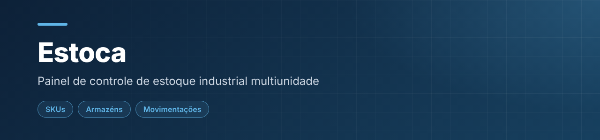
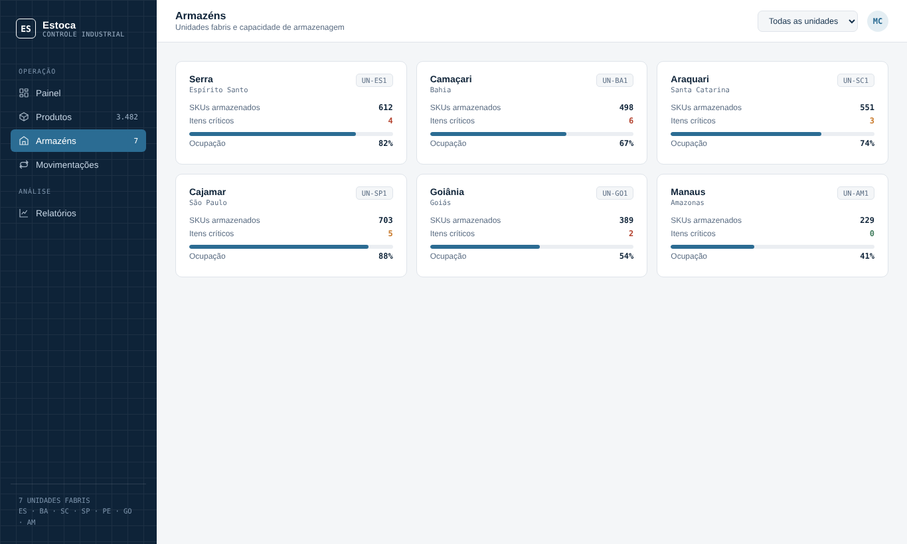

  

<h1 align="center">Estoca · Controle de Estoque Industrial</h1>

Painel de controle de estoque multiunidade para um parque industrial. Projeto de portfólio com dados simulados.

  

     

---

## 📌 Sobre

Painel de acompanhamento de estoque de um parque industrial com 7 unidades fabris simuladas, com foco em itens abaixo do mínimo, transferências em trânsito e valor em estoque.

## 🖼️ Demonstração

  
   Visão por armazém, com ocupação e itens críticos

## ✨ Funcionalidades

- Indicadores de SKUs ativos, itens abaixo do mínimo, transferências em trânsito e valor em estoque
- Gráficos de saldo por categoria e filtro por unidade fabril
- Lista de itens críticos (crítico/atenção) e histórico de movimentações (entrada, saída, transferência)
- Visão por armazém com ocupação

## 🛠️ Tecnologias

`HTML5` · `CSS3` · `JavaScript` · `Chart.js`

## ▶️ Como usar

Abra a demo, ou baixe o repositório e abra o `index.html` no navegador.

Não precisa instalar nada nem rodar servidor: é só HTML, CSS e JavaScript.

## 📝 Observações

Todos os dados (produtos, quantidades, valores e unidades) são fictícios. O Chart.js é carregado por CDN, então é preciso estar online para ver os gráficos.

---

## 👤 Autor

**Daniel da Silva Rezende** — estudante de Engenharia de Software e Análise e Desenvolvimento de Sistemas.

